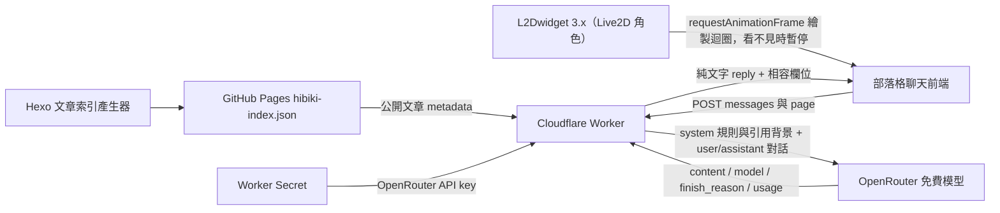
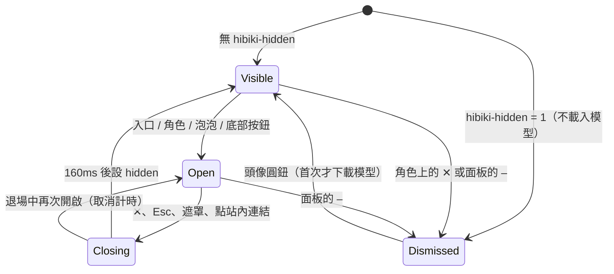
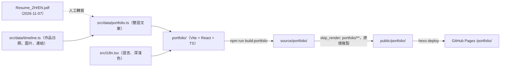
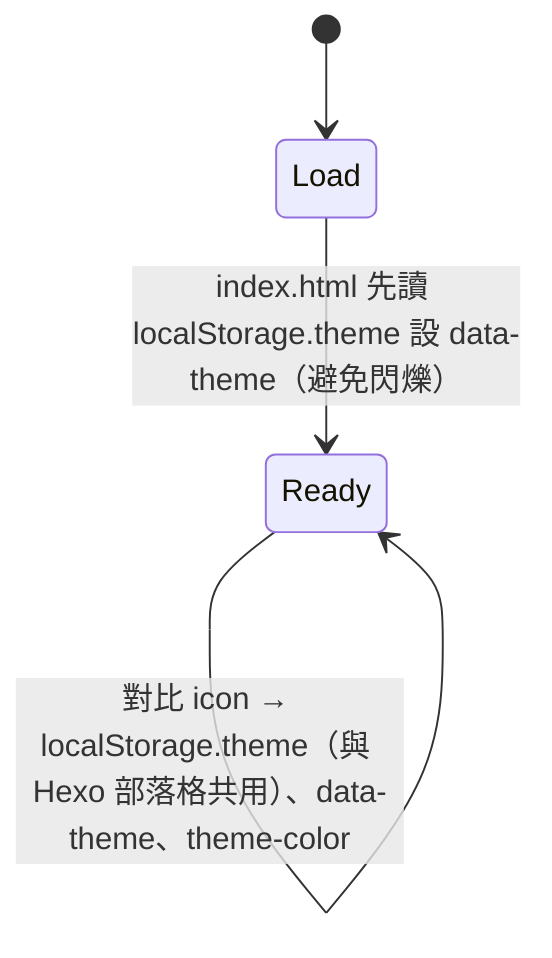

# 系統設計：Hibiki 聊天

本文件記錄此次調整涉及的 Hibiki 元件，其他部落格功能仍見各自的 `docs/decisions/`。更新日期：2026-09-28。

## 元件與資料來源

- 前端將可見 user/assistant 歷史與目前文章節錄送往 Worker；不持有 OpenRouter 金鑰。
- 文章索引由 Hexo 在建置時產生，包含 title/url/date/tags/excerpt，不是對話紀錄。當前文章 text 由前端擷取，仍只是前 6,000 字。
- Worker 無資料庫與使用者 session。索引僅在 isolate 內快取，依 INDEX_URL 區別；成功一小時，失敗或無可用文章五分鐘。
- 自動取得的資料是引用內容，沒有指令效力。Worker 把它與來源說明放在 system 的 `site_reference_data` 區塊；JSON 內的 `<`、`>` 跳脫，固定品質規則接在區塊後。訪客的 user 訊息不拼入網站資料、人設或品質指令。
- 所有模型都使用 system role；覆寫模型若拒絕該 role，以現有錯誤備援切換，不偽造訪客曾說過設定或資料。

## 前端版面與顯示狀態

`themes/cactus/source/js/live2d-chat.js` 的 `syncLayout()` 是唯一控制點：依視窗尺寸決定模式，並以 `dismissed`（訪客收起 Hibiki，存在 `localStorage` 的 `hibiki-hidden`）收斂所有浮動元素。樣式在 `themes/cactus/source/css/_live2d.styl`。

| 模式 | 條件 | 入口 | 聊天面板 | 待機泡泡 |
|---|---|---|---|---|
| `full` | 寬 ≥ 960 且高 ≥ 520，且 L2Dwidget 已載入 | Live2D 角色（right 26、92×184）＋左側「問 Hibiki」 | right 128 / bottom 24，取代入口的位置 | 頭頂上方 bottom 196，尾巴對準角色中心 |
| `compact` | 其餘寬 ≥ 500，或手機非文章頁 | 「問 Hibiki」 right 24 / bottom 76（手機 16 / 74）；< 700px 往下捲時收成 44px 圓鈕 | ≥ 500：right 24 / bottom 76，取代入口；< 500：bottom sheet | bottom 132，入口上方；< 500 不顯示 |
| `mobilebar` | 寬 < 500 且頁面有 `#actions-footer`（文章頁） | 底部操作列的 Hibiki 按鈕，無浮動元素 | bottom sheet | 不顯示 |

- 960 的由來：文章欄 720px 置中，右側留白要放得下角色的 118px（26 + 92）。窄於此角色會站在內文上，透明 hitbox 還會擋住連結。
- 面板只有紀錄區會縮（`min-height: clamp(0px, 100vh - 300px, 120px)`），`overflow: clip` 讓 `focus()` 無法捲動面板，短螢幕時標題列不會被捲出去。
- 觸控手機（寬 < 500 且 `pointer: coarse`）開啟時 focus 對話框本身，不自動彈出鍵盤；其餘 focus 輸入框。

- 開關由 `showEl()` / `hideEl()` 處理：退場先加 `.is-leaving` 播 160ms 反向動畫再設 `hidden`，退場中不接收點擊（`#waifu-chat > .is-leaving`）；`prefers-reduced-motion` 時直接切換。泡泡 6.5 秒後同樣以退場動畫消失。
- Live2D 暫停：L2Dwidget 沒有暫停 API，`live2d-chat.js` 包裝 `window.requestAnimationFrame`，只攔第二參數是 `#live2dcanvas` 的呼叫。角色看不見（`dismissed` 或不在 `full`）時停住，出現時接回同一條迴圈。決策見 `docs/decisions/2026-09-28-hibiki-live2d-raf-pause.md`。

## POST 聊天介面

沿用現有 Worker 網址與 POST/OPTIONS，沒有新增 endpoint。CORS 預設允許正式站及 localhost:4000，回傳 `Vary: Origin`；CORS 不等於濫用防護。

| 方向 | 欄位 | 說明 |
|---|---|---|
| Request | `messages` | `{role: user\|assistant, content: string}[]`；忽略客戶端 system 及無效/空白訊息，尾端必須是 user |
| Request | `page` | 選填 `{title, text}`；title 最多 100 字，text 最多 6,000 字 |
| Response | `reply` | 已清理 Markdown 的純文字；保留換行、顏文字、站內路徑 |
| Response | `model` | 上游回報的實際模型；缺少有效 ID 時使用此次要求的模型 |
| Response | `finish_reason` | `stop`、`length` 或 `null`（上游未提供）；未知結束原因不視為完成 |
| Response | `truncated` | 已知輸出截斷且仍有可用片段時為 true；同時在 reply 附未完成提示供舊前端顯示 |
| Error | `error` | 穩定的分類文字，不透傳供應商原始錯誤 |

HTTP 狀態：錯誤 JSON 或無有效 user 訊息為 400；錯誤 method 為 405；請求 body 讀取逾時為 408；缺少 key 或不允許的 MODEL 為 500；上游全部失敗且沒有可用片段為 502。成功與明示未完成的可用片段均為 200。

歷史限制為最近 20 則、每則前 2,000 字、合計 16,000 字，使用 JavaScript 字串長度。從最新輪次往回保留，超限刪最舊整輪，剔除缺少問題的開頭 assistant。**目前前端只傳最近 10 則，Worker 無法補回未收到的舊問題；換文章或重新整理仍會清空前端歷史。**

## 上游請求流程

1. 從進入 fetch 起計算全請求 60 秒期限；驗證 method、key、免費 MODEL 與 body。
2. 抓取或讀取索引快取；抓取加 JSON 解析共最多三秒，也不能超過全請求期限。失敗標示無索引，聊天繼續。
3. 組裝人設、來源明確的引用背景、固定品質規則及原始角色對話。固定規則優先於自訂人設中的舊長度限制。
4. 模型順序為 MODEL（若有）→ Qwen3.8 27B free → Ling 3.0 Flash Sante free，去重。僅允許具名 `:free` ID，拒絕 OpenRouter 動態路由；provider 輸入/輸出/單次請求價格上限皆設為 0。
5. 正常預算 1,200 tokens、temperature 0.6；Qwen 的模型專屬參數關閉可選推理，其他模型不送未確認的推理參數。
6. 遇到 `length`，全請求最多一次同模型重新生成，預算 2,400 tokens，重新回答原問題，不拼接未完成內容。再截斷時回傳可用片段與未完成提示；沒有可用片段或重試故障則可用備援。
7. 每次模型呼叫最多 25 秒（包含 body），整個請求最多三次模型呼叫且共享 60 秒期限。遇 401/403 停止，不因 body 非 JSON 而繼續；內容過濾直接回錯誤，不切換模型繞過。
8. 清理完成的文字後回傳；備援耗盡但保留過可用截斷片段時，明示未完成。每次嘗試記錄結束原因、耗時與 token 用量，不記錄文字內容。

## 對話品質與驗證邊界

- 閒聊自然簡短；技術解釋通常 200–400 字，不強迫所有問題都變成部落格導覽。
- 文章節錄與索引摘要不能當成全文；只推薦真實索引項目，未知內容要明說。
- 不主動提 JSON 或內部機制；問資料來源時說網站自動提供的公開文章資料。若先前把背景資料說成訪客貼的，承認錯誤；不把先前 assistant 的誤述當證據。
- Node 原生測試驗證真實 Worker 入口的資料流、期限與回傳，來源歸因案例驗證 user 訊息未被程式附加背景資料污染。模型實際理解、繁體中文品質與資訊正確性仍需要固定問答人工比較；流程見 Worker README。
- 本次未新增串流、長期記憶、速率限制、全文檢索或資料庫，也未部署至正式環境。

---

# 系統設計：Portfolio SPA（/portfolio/）

獨立的作品精選頁，只從外部連結（作品集 QR code）進入，部落格首頁、選單、About 與文章都不連入；全名、雇主等個人資訊只出現在這一頁（見 `docs/decisions/2026-11-07-blog-identity-revert.md`）。技術邊界沿用 `docs/decisions/2026-09-28-portfolio-spa-react.md`，版型見 `docs/plans/2026-11-07-portfolio-self-intro-layout.md`、`docs/plans/2026-11-07-portfolio-resume-bilingual.md`。更新日期：2026-11-07。

## 元件與建置流程

- `portfolio/` 是獨立的 npm 專案；React 只打包在這一頁。React Bits 來源與授權保留但不引用。
- 個人資料（姓名、職稱、雇主、學歷、信箱）只寫在 `portfolio/src/`，不放在 Hexo 的 `source/_data/`，部落格主題讀不到。電話不公開。
- 事實來源：經歷、研究、獎項以使用者提供的新履歷為準；作品日期、圖片與連結取自 `timeline.ts`，以 `node(id)` 讀取。
- 所有文案是 `{ zh, en }`，元件以 `useT()` 取當前語言。
- 中文換行：About 自介以 `|` 手動標出詞組斷點（`Phrases`）；其餘中文內文用 `components/Wrap.tsx`，以 `Intl.Segmenter('zh-Hant', word)` 把每個中文詞包成 no-wrap span，只在詞與詞之間換行；配合 `p, li { text-wrap: pretty }` 避免最後一行只剩一兩字。英文與不支援 Segmenter 的瀏覽器照原本方式換行；≤340px 時自介詞組恢復一般換行以防溢出。
- 樣式只有 `src/site.css`（墨綠／嫩綠 tokens；`html[data-theme="light"]` 覆寫）。標題與內文統一 DM Sans + Noto Sans TC，日期與 tag 用 JetBrains Mono。
- build 產物進版控。修改 `portfolio/` 後必須重跑 `npm run build:portfolio`，`hexo generate` 只負責複製。
- 頁面帶 `noindex, nofollow`；`<noscript>` 內有純連結清單。

## 語言與深淺色

- 語言預設中文；切換只改 React state 與 localStorage，不改 URL。
- localStorage 讀寫包在 try/catch，無法存取時仍可切換，只是不保留。

## 頁面區塊（自介版型）

| 區塊 | 檔案 | 內容 |
|---|---|---|
| Header | `sections/About.tsx` | sticky：姓名、區塊導覽＋部落格、中／EN 切換、深淺色切換；手機為兩列，導覽可橫向捲動 |
| About `#about` | `sections/About.tsx` | 姓名（中英同字體）、職稱、依履歷改寫的自介、技術筆記連結、Email／GitHub |
| Experience `#experience` | `sections/Experience.tsx` | 程曦資訊（官方 logo；軟體設計工程師、創新研發部實習生兩段職務的履歷條列）、銘傳大學（校徽、2021–2025） |
| Milestones `#milestones` | `sections/Milestones.tsx` | 日期＋一句話的事件，預設 6 則，可展開 |
| Research `#research` | `sections/Research.tsx`、`sections/Hero.tsx` | 自動播放：空拍影格 → 依 `lib/tiles.ts` 逐塊掃描 7×5 重疊切片 → 2024 分割輸出；進入視窗才播放，點按鈕改手動、↻ 重播；`prefers-reduced-motion` 直接顯示輸出。右側為履歷的「我做了什麼」 |
| Projects `#projects` | `sections/Projects.tsx`、`components/Zoomable.tsx` | 6 張卡片（圖或影片、一句話、tags、連結），原生 `<dialog>` 放大；「其他作品」列表 |
| Awards `#awards` | `sections/Awards.tsx` | 獎項、研究補助、證照 |
| Footer | `sections/Awards.tsx` | 置中的 Email／GitHub／部落格 icon 與版權 |

- 影片（mien，取自 repo 既有 demo.gif 轉 mp4）在卡片內 muted loop 自動播放；放大檢視開啟才播放、關閉即暫停。
- 所有影像都是真實資料（專題輸出、實際執行截圖、作品既有 demo），不繪製模型沒有輸出過的偵測框。文案以個人貢獻為主，不放限制／待補段落。
- logo 取自程曦資訊與銘傳大學官網，裁成 128px 方形，放在白底圓角框以適應深色背景，僅作經歷識別。

## 建置與檢查

1. `npm run build:portfolio`：TypeScript + Vite，更新受版本控制的 `source/portfolio/`。
2. `npm run build`：Hexo 文章、主題與靜態頁輸出。
3. `python tools/verify-site.py`：逐位元檢查 Portfolio 複製、文章路由、JSON-LD、主要頁面的連結與資產。工具放在 `tools/`，避免 Hexo 將 `scripts/` 內容當作 JS plugin 自動載入。
4. 瀏覽器另驗證 fragment 導覽、中英與深淺色切換、研究動畫、放大檢視（Esc／背景關閉）、鍵盤與響應式。Noindex 延續既有設定，並非存取控制。
