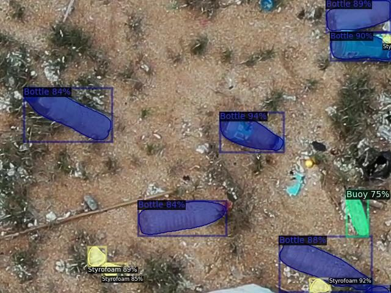
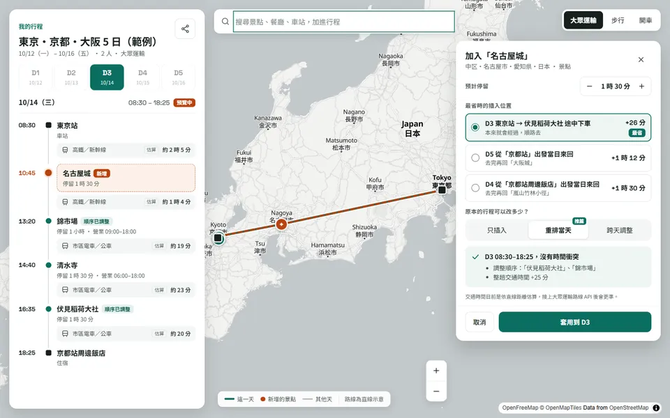
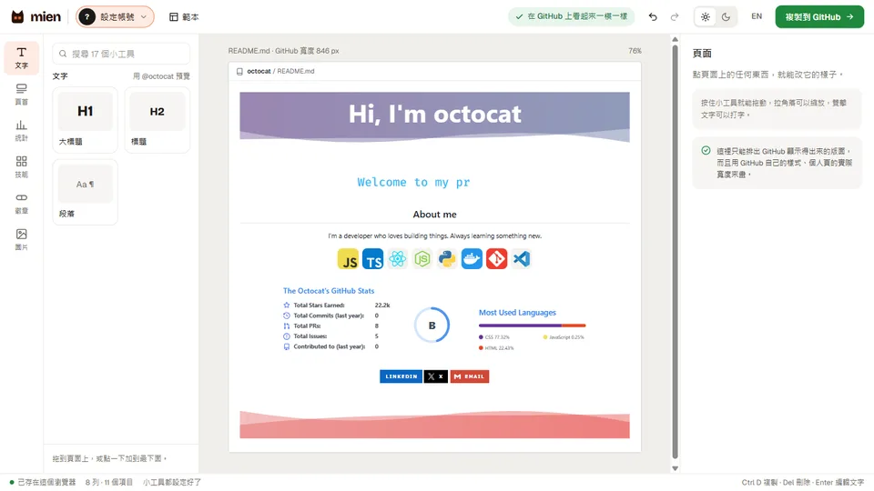
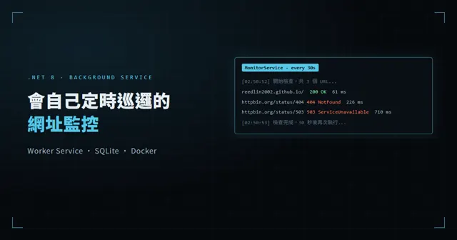

關於 Lin

<section class="about-intro" id="intro">

## 你好，我是 Lin

我做跨平台 App，也做電腦視覺與 AI 相關的實作。從需求釐清、介面開發到原生能力整合、問題排查與版本發布，我在意的是功能能不能解決問題，以及之後能不能持續維護。

這裡整理我的作品、技術筆記與設計取捨。除了記下怎麼做，我也想說清楚為什麼這樣做，以及方法有哪些限制。

<nav class="about-links" aria-label="關於頁章節"><a href="#practice">技術實作</a><a href="#research">研究專題</a><a href="#selected-projects">精選作品</a><a href="/archives/">所有文章</a></nav>

</section>

<section class="about-section" id="practice">

## 技術實作

### 跨平台 App 與原生整合

使用 React、TypeScript、Vite 與 Capacitor 開發 Android／iOS App，串接 GraphQL API，處理 Deep Link、推播通知與 NFC 等原生能力。遇到平台差異時，先用小型 Prototype 驗證，再決定正式流程。

### 電腦視覺與資料處理

使用 Python、OpenCV 與 PyTorch 處理影像資料，涵蓋標註整理、資料增強、模型微調與評估。實作過 Detectron2／CenterMask2 的實例分割流程，也關注模型在不同影像條件下的表現。

### AI 工具與軟體工程

使用 Claude Code、Codex、MCP 與 Skills 輔助開發，持續整理規格驅動開發的工作方式。重點是讓需求、實作與驗證對得起來，讓產生的程式碼能被理解與維護。

</section>

<section class="about-section" id="research">

## 研究專題

### 海灘垃圾自動監測

以 UAV 空拍影像建立海灘垃圾監測流程，透過 CenterMask2 辨識保麗龍、寶特瓶、木材、浮標與浮球，再依團隊的量化方法呈現海灘清潔指數（CCI）與塑膠豐度指數（PAI）。

我參與影格擷取、影像取樣與 OpenCV 全景拼接，整理與標註資料，實作少數類別的資料增強，並進行模型微調、評估與結果視覺化。

<a href="/2026/11/17/beach-litter-monitoring/">專題介紹</a><a href="/2026/08/23/uav-vision-notes/">技術筆記</a>

<figure class="research-visual">

<figcaption class="about-caption">專題系統的實際輸出，取自專題論文。</figcaption>
</figure>

</section>

<section class="about-section" id="selected-projects">

## 精選作品

### 智慧旅程規劃

以地圖編輯行程。AI 產生初稿後，加入景點時列出多繞時間較少的插入位置，預覽確認才套用，也能復原。

React · TypeScript · MapLibre GL

<a href="/2026/09/28/smart-trip-planner/">設計與實作</a>

### mien

GitHub 個人頁 README 的視覺化編輯器。用拖拉小工具的方式排版，再複製產生的內容。

React · TypeScript · GitHub Actions

<a href="https://mien.kanewolf98.workers.dev/">試用 mien</a>

### UrlHealthMonitor

網站可用性與回應時間監控。由背景服務定時檢查並存入 SQLite，搭配 xUnit 測試與 Docker 部署。

.NET · SQLite · Docker

<a href="/2025/07/05/UrlHealthMonitor/">設計與實作</a>

<a href="/#projects">更多作品</a>

</section>

<section class="about-section" id="interests">

## 目前關注

- **模型的跨環境穩定性**：除了單一資料集的結果，也想理解拍攝高度、物件尺寸與背景變化如何影響辨識。
- **可驗證的 AI 開發流程**：把需求寫清楚，建立合適的檢查方式，再讓工具協助實作。
- **介面與系統的取捨**：從使用情境出發，用 Prototype 釐清平台能力與操作流程。

相關實作與學習過程會持續整理在[技術文章](/archives/)裡。

</section>

